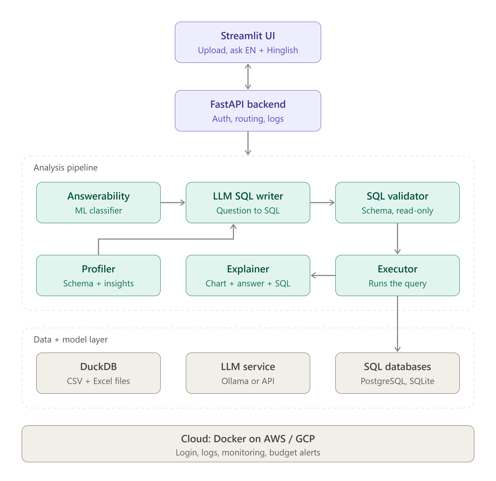

# DataCopilot

**Ask questions about your CSV files or SQL databases in plain English or Hinglish, and get verified answers with charts and the exact SQL used.**

> Capstone project, Saras AI Institute · Author: Mritunjay Sharma · Supervisor: Akshay Taneja

## Why DataCopilot?

AI data tools often run LLM-generated queries without checking them, which can return wrong numbers that *look* right. DataCopilot focuses on **reliability**:

- The LLM **only writes SQL**. It never calculates.
- A **validator** checks every query for schema correctness and read-only safety before it runs.
- An **ML classifier** detects questions the data can't answer, so the system declines instead of guessing.
- Every answer shows the **SQL used** so users can verify it.

## Features (planned)

| Feature | Status |
|---|---|
| CSV / Excel upload (DuckDB) | Planned |
| SQLite / PostgreSQL connection | Planned |
| English + Hinglish questions | Planned |
| Automatic dataset insights | Planned |
| Answerability classifier | Planned |
| SQL validation (schema + read-only) | Started |
| Auto chart selection (Plotly) | Planned |
| Cloud deployment (Docker, AWS/GCP) | Planned |

## Architecture



Flow: **UI → FastAPI → answerability check → LLM writes SQL → validator → executor (DuckDB / database) → explainer (chart + answer + SQL)**

## Tech stack

Python · Pandas · DuckDB · SQLite / PostgreSQL · SQLAlchemy · scikit-learn / XGBoost · Ollama (open-source LLMs) · sqlglot · FastAPI · Streamlit · Plotly · Pytest · Docker · AWS / GCP

## Evaluation

- **BIRD** text-to-SQL benchmark (dev set)
- Custom CSV, Hinglish, and unanswerable question sets
- Main comparison: baseline LLM pipeline vs validated pipeline (wrong-answer rate, execution accuracy, correct refusals)

## Project structure

```
datacopilot/
├── docs/            # Proposal, charter, architecture, weekly reports
├── src/datacopilot/ # Application code (api, pipeline, ui)
├── data/            # raw / processed data and benchmarks (large files not committed)
├── notebooks/       # EDA and experiments
├── tests/           # Pytest tests
├── scripts/         # Helper scripts (download data, run evaluation)
└── docker/          # Docker and deployment files
```

## Quick start (development)

```bash
git clone https://github.com/<your-username>/datacopilot.git
cd datacopilot
python -m venv .venv
source .venv/bin/activate      # Windows: .venv\Scripts\activate
pip install -r requirements.txt
cp .env.example .env
pytest
```

## Roadmap

See [docs/planning/milestones.md](docs/planning/milestones.md).

## License

MIT
