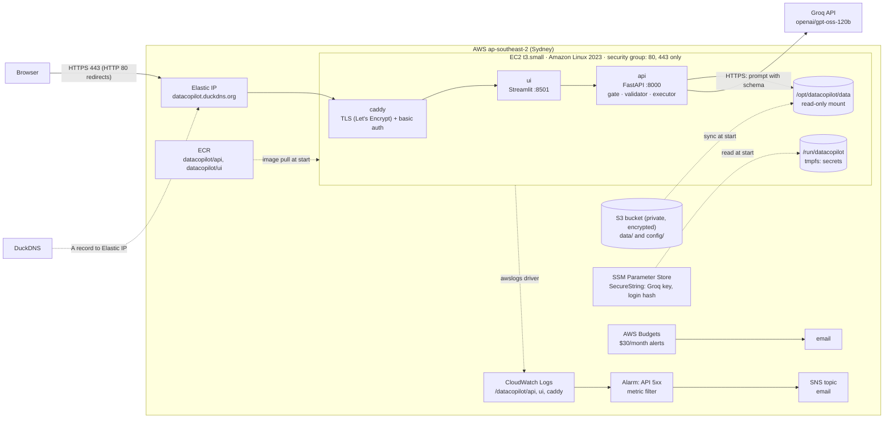
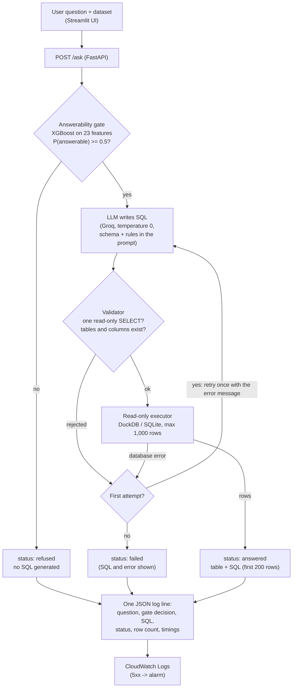

# DataCopilot deployment architecture

Module 5. DataCopilot runs on AWS in **Sydney (`ap-southeast-2`)** as three containers on one
EC2 instance, created and deleted with one command each (`infra/`). How to deploy:
[DEPLOYMENT_GUIDE.md](DEPLOYMENT_GUIDE.md). How to use it: [USER_GUIDE.md](USER_GUIDE.md).
Background and decisions: `docs/notes/module5_plan.md`, `docs/notes/module5_aws_plan.md`.

## 1. Platform choice

**Chosen: one EC2 `t3.small` (2 vCPU, 2 GB, x86) running Docker Compose**, with images in ECR,
data in S3, secrets in SSM Parameter Store and logs in CloudWatch, all in one CloudFormation
stack (`infra/datacopilot.yaml`). The same container images run locally with
`docker-compose.yml`; only the LLM differs (local Ollama vs hosted Groq).

Why: it is the cheapest option that fits the app (the API needs about 735 MB with all four
datasets loaded, so 1 GB instances are too small), keeps an IAM role on the server (no access
keys), works with Session Manager (no SSH), and the whole deployment can be recreated or
deleted in one step.

| Alternative | Why not chosen |
|---|---|
| `t3.micro` (1 GB) | Too little memory for the API with all datasets loaded |
| `t4g.small` (ARM, ~$3.8/month cheaper) | Needs arm64 images; the project builds on x86 (Windows laptop), so the server stays x86 |
| ECS Express Mode / Fargate | Needs a load balancer (~$18/month alone) plus tasks: ~$40+/month for a 2-container demo |
| AWS App Runner | Denied for this account by an organization policy (SCP), and closed to new customers since 2026-04-30 |
| Lightsail (~$12/month) | No IAM instance role (would need long-lived access keys on the server) and no Session Manager |
| Ollama on the server | A 7B model needs a GPU or far more memory than a small instance; the hosted Groq API is used instead |

## 2. AWS infrastructure

| Resource | Purpose | Main settings |
|---|---|---|
| EC2 instance `datacopilot` | Runs `caddy`, `ui`, `api` with Docker Compose | `t3.small`, Amazon Linux 2023 x86_64, 16 GB gp3 encrypted, 2 GB swap, IMDSv2 only, no key pair |
| Elastic IP | Fixed public address for the hostname | Billed also while the instance is stopped |
| Security group `datacopilot-web` | Firewall | Inbound TCP 80 and 443 only; no SSH |
| ECR repositories `datacopilot/api`, `datacopilot/ui` | Container images (`linux/amd64`, tagged with the git commit) | Private, scan on push, keep last 3 images, removed with the stack |
| S3 bucket `datacopilot-<account-id>-apse2` | `data/` (processed datasets, ~250 MB), `config/` (compose file, Caddyfile, bootstrap script, `site.env`) | Block Public Access, SSE-S3 encryption, TLS-only bucket policy |
| SSM parameters `/datacopilot/groq_api_key`, `/datacopilot/basic_auth_hash` | Secrets | SecureString (AWS-managed key); created by `deploy.sh`, not by CloudFormation |
| IAM role `datacopilot-instance` | Instance permissions | Least privilege (section 5) |
| Log groups `/datacopilot/api`, `/datacopilot/ui`, `/datacopilot/caddy` | Container logs | 14-day retention |
| Metric filter + alarm `datacopilot-api-5xx` | Alert on server errors | `{ $.http_status >= 500 }`, sum >= 1 in 5 minutes, to SNS email |
| SNS topic `datacopilot-alarms` | Alarm notifications | Email subscription (confirmed once) |
| Budget `datacopilot-monthly` | Cost guardrail | $30/month, email at 50%, 80%, 100% of actual cost |

## 3. Network

- **Public entry:** only Caddy publishes ports (80 and 443) on the Elastic IP. Port 80 serves the
  Let's Encrypt HTTP-01 challenge and redirects everything else to HTTPS.
- **Internal:** `ui` and `api` are reachable only on the Docker Compose network (`ui` calls
  `http://api:8000`); ports 8000 and 8501 are not published and are closed from the internet.
- **Outbound:** the instance reaches ECR, S3, SSM, CloudWatch (AWS endpoints), the Groq API, Let's
  Encrypt, Docker Hub (Caddy image) and GitHub (Docker Compose plugin download at first boot).
- **Admin access:** AWS Systems Manager Session Manager (`aws ssm start-session`), no SSH port and no
  SSH keys. Deploy updates use SSM Run Command (`systemctl restart datacopilot`).
- **Hostname:** a free DuckDNS subdomain points at the Elastic IP; `deploy.sh` updates it.
  `duckdns.org` is on the Public Suffix List, so Let's Encrypt rate limits apply per subdomain.
- Default VPC, public subnet; IPv4 only.

## 4. Data storage

| Data | Where | Notes |
|---|---|---|
| Processed datasets (Olist SQLite, IPL/F1/crop CSVs, ~250 MB) | S3 `data/`, synced to `/opt/datacopilot/data` at every start | Mounted read-only into the API; SQLite opened with `mode=ro`, CSVs loaded into in-memory DuckDB |
| Answerability model (3 KB) | Inside the API image | Same file as `models/answerability.joblib` |
| Runtime config (image tag, model, hostname, login user) | S3 `config/site.env` | Not secret |
| Secrets | SSM Parameter Store -> `/run/datacopilot` (tmpfs) | Never on disk, in images, in git or in logs |
| TLS certificates | Docker volume `caddy_data` on the instance disk | Survive restarts; renewed by Caddy |
| Request logs | CloudWatch Logs, 14 days | One JSON line per question |

Nothing users type is stored except the request log line. User uploads are not part of this
deployment.

## 5. Security controls

| Area | Control |
|---|---|
| Data safety | The LLM only writes SQL. The validator (sqlglot) allows a single read-only `SELECT`; the executor checks again and SQLite is opened read-only. Write requests ("delete ...") are refused by the gate or rejected by the validator |
| Access | HTTPS only (HTTP redirects), HSTS header; one shared login with HTTP basic auth (bcrypt hash; the password itself is never uploaded) |
| Secrets | Groq key and login hash in SSM SecureString; read at start into tmpfs; never echoed by the scripts; the log formatter redacts secret-looking values as a second line of defence |
| IAM | Instance role allows only: list/read the bucket's `data/` and `config/`, read `parameter/datacopilot/*`, pull the two ECR repositories, write the three log groups, and the minimal Session Manager actions. The managed `AmazonSSMManagedInstanceCore` policy is not used because it can read every parameter in the account |
| Instance | No SSH port or key; IMDSv2 required with hop limit 1 (containers cannot fetch instance credentials); encrypted disk; containers run as a non-root user (`api`, `ui`) |
| Storage | S3 Block Public Access, SSE-S3, TLS-only bucket policy; ECR scan on push |
| Supply chain | Base image `python:3.13.18-slim-bookworm`, Caddy `2.11.9`, Docker Compose `v5.7.0` (SHA-256 checked) pinned; Python packages pinned |
| Monitoring | 5xx alarm to email; AWS Budgets alerts; logs kept 14 days |
| Abuse / cost | Login keeps strangers from using the Groq quota; Groq's free-plan limits cap LLM use |

## 6. Request flow

If Groq's rate limit is hit, the API returns HTTP 429 with a `Retry-After` time and the UI shows
"try again in N s"; the LLM errors (bad key, unreachable) return 503 and trigger the alarm.

## 7. Scalability

The deployment is sized for a demo: one instance, a few concurrent users.

| Limit | Where it comes from | How to go further |
|---|---|---|
| LLM throughput | Groq free plan: 8,000 tokens/minute and 1,000 requests/day per model (a few questions per minute) | Paid Groq tier or another hosted model; the provider is one setting (`LLM_PROVIDER`) |
| Queries per dataset | Each dataset has one shared connection behind a lock, so queries on the same dataset run one at a time (most finish in well under a second) | More API workers or replicas, each with its own connections |
| Memory | ~735 MB for the API with all datasets loaded, ~100 MB per active UI session, 2 GB RAM + 2 GB swap | Larger instance type (change `AllowedValues` in the template) |
| Single instance | No load balancer, no failover | The API is stateless and data comes from S3, so it can move to ECS/Fargate behind a load balancer with several tasks (at ~$40+/month) |

## 8. Cost

Sydney on-demand prices from the AWS Price List API (2026-11-24); usage is paid from the
account's Free-plan credits.

| Item | Per day | Per month |
|---|---|---|
| EC2 `t3.small` ($0.0264/h) | $0.63 | $19.27 |
| Elastic IP / public IPv4 ($0.005/h) | $0.12 | $3.65 |
| EBS gp3 16 GB | $0.05 | $1.54 |
| S3, ECR, CloudWatch Logs, 1 alarm | < $0.01 | ~$0.20 |
| SSM Parameter Store (standard), SNS email, Budgets, data out < 100 GB | $0 | $0 |
| **Running 24/7** | **~$0.81** | **~$24.7** |
| **Instance stopped** (disk and IP only) | **~$0.17** | **~$5.2** |

Stop the instance between demos (`infra/stop.sh`) and delete everything when done
(`infra/delete.sh`). Groq's free API costs nothing; DuckDNS and Let's Encrypt are free.
