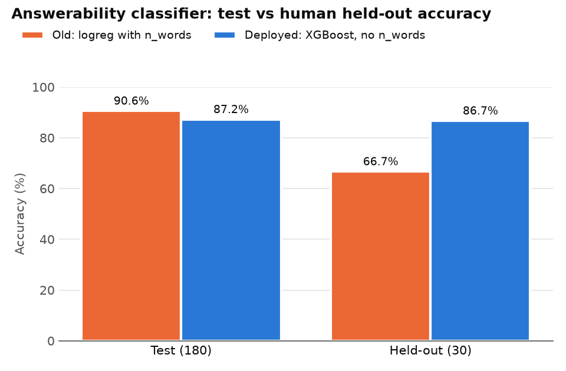
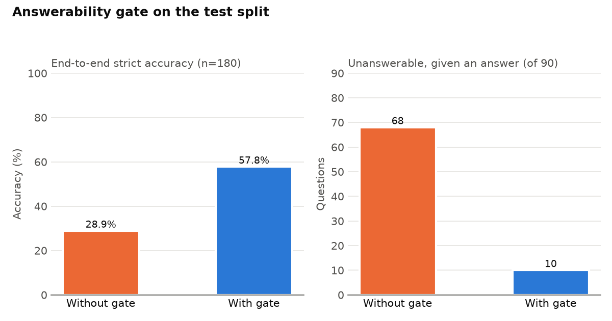
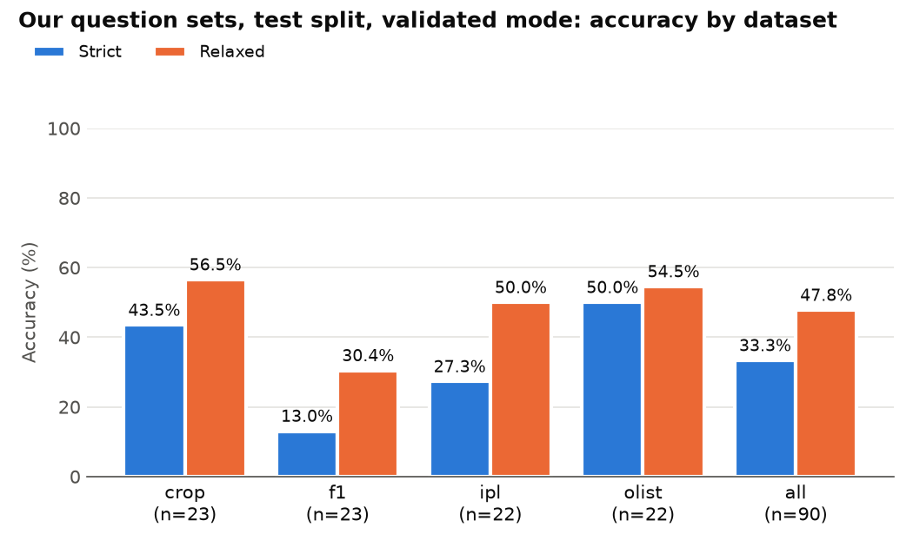
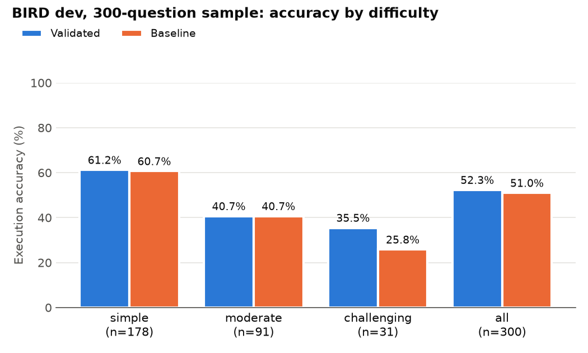

# Module 4 summary: answerability classifier and pipeline experiments

DataCopilot lets the LLM (qwen2.5-coder:7b via Ollama, temperature 0) write SQL only; a
sqlglot validator checks it; the database computes every number. Module 4 asks two
questions: **(1) can a small classifier tell answerable from unanswerable questions before
any SQL is written, and (2) does schema validation with one retry make the SQL more
accurate?** Details in `README.md` (notes) and the generated reports beside it; figures in
`figures/` (made by `scripts/make_figures.py`).

## Key numbers

| Experiment | Data | Result | Paired test (exact McNemar) |
|---|---|---|---|
| Answerability classifier (deployed: XGBoost, 23 features, no `n_words`) | Test split, 180 (90/90) | **87.2%** accuracy; unanswerable precision 86.8%, recall 87.8% | n/a |
| | Human held-out, 30 (15/15) | **86.7%** accuracy | n/a |
| Answerability gate, end-to-end strict accuracy | Test split, 180 | **28.9% to 57.8%**; invented answers to unanswerable questions 68 to 10 of 90; 12 false refusals of 90 | gate only right 58, no gate only right 6, **p < 0.0001** |
| | Human held-out, 30 | 23.3% to 53.3% | **p = 0.012** |
| SQL pipeline, validated vs baseline, strict (relaxed) | Our test split, 90 answerable | 33.3% vs 33.3% (47.8% vs 47.8%) | 0 discordant, **p = 1.0** |
| | Held-out answerable, 15 | 20.0% vs 20.0% (46.7% vs 46.7%) | 0 discordant, p = 1.0 |
| BIRD dev, validated vs baseline (execution accuracy) | 300 questions, seed 42, stratified by database | **52.3% vs 51.0%** | validated only right 4, baseline only right 0, **p = 0.125** |

## Main findings

1. **The answerability gate is the largest effect in Module 4.** Without it the pipeline
   answers almost anything: 68 of 90 unanswerable test questions got an invented result,
   and the other 22 failed only because the SQL broke. With the gate, end-to-end strict
   accuracy doubles (28.9% to 57.8%). The cost is 12 false refusals, 6 of which the
   pipeline would have answered correctly (answerable accuracy 33.3% to 26.7%).
2. **Write requests never modified data.** All 17 test write requests were refused by the
   gate; without it, the validator rejected 12 and the model rewrote 5 as harmless SELECTs.
3. **Schema validation helps rarely and never hurts.** On BIRD it fixed 4 of 59 queries that
   crashed in baseline (3 of them `challenging`: 35.5% vs 25.8% on that tier) and never
   rejected a query that would have run; on our sets it changed no outcome. The gain is not
   significant at these sample sizes.
4. **Most SQL failures are valid SQL with the wrong answer** (91 of 143 validated BIRD
   failures; 55 of 60 on our test split), which a schema check cannot catch. Accuracy is
   lowest on F1 (13.0% strict) and on Hinglish questions (26.7% vs 36.7% English).
5. **A length shortcut was found and removed.** The first model (logistic regression with
   `n_words`) scored 90.6% on test but 66.7% on the human held-out set: our unanswerable
   questions were written shorter, so question length predicted the label. Without
   `n_words` held-out accuracy rose to 83.3% (logreg) and 86.7% (deployed XGBoost).

## Limitations

- **`n_words` decision used the held-out set.** The held-out set was used once, to decide
  to drop `n_words`; it is no longer fully untouched, so the 86.7% held-out accuracy is
  somewhat optimistic. Nothing else was tuned on it, and no features were added from its
  errors. It is also small (one question = 3.3 points) and AI-drafted, human-edited.
- **Relaxed metric defined after seeing results.** The relaxed rules (key columns without the
  aggregate; order only for top-N) were fixed after the first step 3 run. Strict is the
  primary metric; relaxed numbers are not a pre-registered measurement. BIRD uses its
  standard execution accuracy, unchanged.
- **50/50 unanswerable mix.** Half of our evaluation questions are unanswerable by
  construction, which makes the gate dominate end-to-end accuracy. In real use, with fewer
  unanswerable questions, false refusals weigh more and the net gain will be smaller.
- **Vocabulary gap.** The classifier refuses questions about computed metrics ("sixes",
  "economy", "podiums") and lowercase names ("kohli") because they match no column name
  (`schema_overlap` = 0). `missing_column` is the weakest unanswerable type (7 of 20 pass
  the gate on test). Planned for Module 6, to be validated on new questions.
- **Scale.** One 7B model, no few-shot examples, a 300-question BIRD sample (not the full
  1,534), and 90 answerable test questions per mode.
